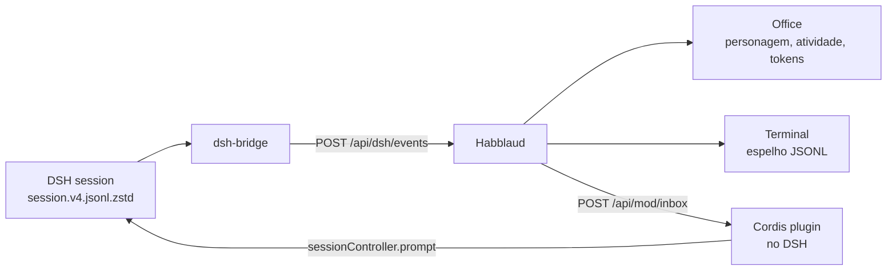

# DeepSeek Harness in Habblaud: the full guide

Habblaud already showed Claude Code and Codex. This guide adds **DeepSeek Harness (DSH)** as a first-class agent:
its own **DSH** badge, project room, live activity, **token usage** (session, 5 h and week), a **terminal** with the
conversation, and **messages from the office** — all local, with no credentials leaving the machine.

> Status: local integration, not upstream. It lives in this fork/patch; upstream Habblaud does not know the `dsh`
> provider yet. The guide assumes macOS (Linux should work with small changes).

## What you get

- Every open DSH session becomes a character in its project room.
- Live activity: prompt, tool, result, approval, end of turn.
- Account card with **tokens in the session, 5 h and week** (DeepSeek bills per token; there is no percentage quota).
- **T** terminal with the conversation (prompts, commands, results).
- A working **Send message** box: the text enters the session as a prompt.
- Replays automatically when Habblaud restarts; the character leaves when the DSH session closes.

## How it works

```
~/.dsh/sessions/**/session.v4.jsonl.zstd
        │  (zstd → JSONL, open sessions via session.lock/lsof)
        ▼
scripts/dsh-bridge.ts  ──POST /api/dsh/events──▶  Habblaud (dsh provider)
        │                                             │
        │                                             ├─ Office: character, activity, tokens
        │                                             ├─ Terminal: JSONL mirror in /data/dsh
        │                                             └─ /api/mod/inbox
        │                                                     ▲
        └──────────────  Cordis plugin in DSH  ───────────────┘
                        (sessionController.prompt)
```



## Requirements

- Habblaud installed and running (`npm run docker:up` or `npm start`).
- Node.js 22.12+.
- `zstd` on PATH (`brew install zstd`).
- `lsof` (bundled with macOS; on Linux, `apt install lsof`).
- DeepSeek Harness with an open session.

## 1. Habblaud with the DSH provider

This repository already contains the changes. On a clean clone, download `docs/deepseek-harness.patch` from this fork
and apply it:

```bash
git clone https://github.com/marmottajr/habblaud.git
cd habblaud
# copy the patch to docs/deepseek-harness.patch (or download it from the Gist/release)
git apply docs/deepseek-harness.patch
npm install
npm run docker:up
```

If upstream has moved and the patch no longer applies, the key files are listed at the end of this guide; port them by
hand.

Check:

```bash
curl -s http://localhost:4747/api/health | grep -o '"dshEvents":true'
```

`sources` in `/api/health` should include `.dsh`.

## 2. Bridge DSH → Habblaud

```bash
cd ~/habblaud
npm run dsh:bridge -- --all
```

- `--all`: every open session, in any project.
- `--workspace ~/my-project`: only that folder's sessions.
- `--session ~/.dsh/sessions/.../session.v4.jsonl.zstd`: one specific session.

Keep it running. On macOS, a `KeepAlive` LaunchAgent works (see the Portuguese guide for the full plist), or run it
under your process manager of choice.

Log: `~/.habblaud/dsh-bridge.log`.

## 3. Messages from the office (DSH plugin)

Habblaud cannot type into the DSH session on its own. The `mod/habblaud-dsh-inbox` plugin bridges it:

```bash
cp ~/habblaud/mod/habblaud-dsh-inbox/plugin.mjs ~/.dsh/profiles/desktop/habblaud-inbox.mjs
```

Append to `~/.dsh/profiles/desktop/cordis.patch.yml`:

```yaml
# Habblaud: office message box -> DSH session (local plugin).
- insert:
    - id: habblaud-dsh-inbox
      name: "./habblaud-inbox.mjs"
```

DSH hot-reloads the profile (HMR). If it does not, reopen DSH. Log: `~/.habblaud/dsh-inbox.log`.

## 4. Using it

1. Open Habblaud and DSH in the same project.
2. The **DSH** character appears in the room.
3. Click the agent and press **T** to open the terminal.
4. To talk, use **Send message** or the terminal footer.
5. If the agent is busy, the message is queued and becomes the next turn.

## Troubleshooting

| Symptom | Check |
| --- | --- |
| No DSH agent | `tail ~/.habblaud/dsh-bridge.log`; check `zstd`/`lsof`; run `npm run dsh:bridge -- --all` |
| Terminal 404 / "local access only" | `docker exec habblaud ls -lh /data/dsh`; open via `http://localhost:4747` |
| Message box shows a plugin hint | `tail ~/.habblaud/dsh-inbox.log`; check the `cordis.patch.yml` block |
| `canMessage: false` | plugin not running or DSH did not reload; check the log |
| Zero tokens | no `assistant/message` in the window; these are tokens, not a quota |
| Habblaud restarted | the bridge detects `bootAt` and replays sessions within 10 s |

## Privacy and security

- Bridge and plugin only talk to `127.0.0.1`.
- No credentials: Habblaud reads session events and writes a JSONL mirror for the terminal.
- The mirror lives in `/data/dsh` (container volume) and contains the conversation; treat it as local data.
- The plugin runs inside DSH with the session's powers; review it before installing.

## Limitations

- Text messages only (no attachments).
- Approvals show up in the office but are answered in the DSH terminal.
- Habblaud World does not accept `dsh` yet (its protocol only knows Claude Code and Codex).
- The integration is not upstream; it is a local patch/fork.

## Key files

- `server/sources/dsh/source.ts` — agent source.
- `server/sources/dsh/terminal.ts` — terminal parser.
- `server/dsh/http.ts` — `POST /api/dsh/events`.
- `scripts/dsh-bridge.ts` — zstd session reader.
- `mod/habblaud-dsh-inbox/plugin.mjs` — DSH plugin.
- `client/src/ui/usage.ts` — token card.
