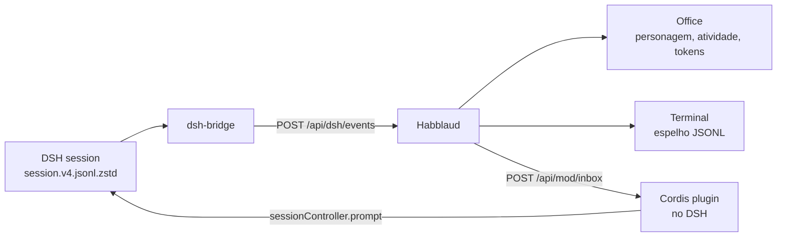

# DeepSeek Harness no Habblaud: o guia completo

O **Habblaud** já mostrava Claude Code e Codex. Este guia adiciona o **DeepSeek Harness (DSH)** como um agente de
primeira classe: personagem com selo **DSH**, sala do projeto, atividade ao vivo, **tokens** (sessão, 5 h e semana),
**terminal** com a conversa e **mensagens pelo escritório** — tudo local, sem credenciais saindo da máquina.

> Status: integração local, não upstream. Ela vive neste fork/patch; o Habblaud oficial ainda não conhece o provider
> `dsh`. O guia assume macOS (Linux deve funcionar com pequenos ajustes).

> **Quer só instalar?** O [`INSTALAR-DSH.md`](INSTALAR-DSH.md) traz o caminho curto, do zero, com um comando
> (`npm run dsh:install`). Este guia explica a integração por dentro.

## O que você ganha

- Cada sessão aberta do DSH vira um personagem na sala do projeto.
- Atividade ao vivo: prompt, ferramenta, resultado, aprovação, fim de turno.
- Cartão da conta com **tokens da sessão, 5 h e semana** (o DeepSeek cobra por token, não tem cota percentual).
- Terminal **T** com a conversa (prompts, comandos, resultados).
- Caixa **Mandar mensagem** funcionando: o texto entra na sessão como um prompt.
- Reconexão automática quando o Habblaud reinicia; o personagem sai quando a sessão do DSH fecha.

## Como funciona

```
~/.dsh/sessions/**/session.v4.jsonl.zstd
        │  (zstd → JSONL, sessões abertas via session.lock/lsof)
        ▼
scripts/dsh-bridge.ts  ──POST /api/dsh/events──▶  Habblaud (provider dsh)
        │                                             │
        │                                             ├─ Office: personagem, atividade, tokens
        │                                             ├─ Terminal: espelho JSONL em /data/dsh
        │                                             └─ /api/mod/inbox
        │                                                     ▲
        └──────────────  plugin Cordis no DSH  ───────────────┘
                        (sessionController.prompt)
```



## Requisitos

- Habblaud instalado e rodando (`npm run docker:up` ou `npm start`).
- Node.js 22.12+.
- `zstd` no PATH (`brew install zstd`).
- `lsof` (já vem no macOS; no Linux, `apt install lsof`).
- DeepSeek Harness com uma sessão aberta.

## 1. Habblaud com o provider DSH

Este repositório já contém as mudanças. Num clone limpo, baixe o `docs/deepseek-harness.patch` deste fork e aplique:

```bash
git clone https://github.com/marmottajr/habblaud.git
cd habblaud
# copie o patch para docs/deepseek-harness.patch (ou baixe do Gist/release)
git apply docs/deepseek-harness.patch
npm install
npm run docker:up
```

Se o patch não aplicar por causa de mudanças recentes no upstream, os arquivos-chave estão listados no fim deste guia;
dá para portar à mão.

Confira:

```bash
curl -s http://localhost:4747/api/health | grep -o '"dshEvents":true'
```

O `sources` do `/api/health` deve mostrar `.dsh`.

## 2. A ponte DSH → Habblaud

```bash
cd ~/habblaud
npm run dsh:bridge -- --all
```

- `--all`: todas as sessões abertas, de qualquer projeto.
- `--workspace ~/meu-projeto`: só as sessões daquela pasta.
- `--session ~/.dsh/sessions/.../session.v4.jsonl.zstd`: uma sessão específica.

Deixe rodando. Para não precisar lembrar disso, `npm run dsh:install` cria o serviço (LaunchAgent no macOS, systemd
no Linux/WSL), que sobe no login e reinicia sozinho — veja [`INSTALAR-DSH.md`](INSTALAR-DSH.md). Se preferir criar à
mão, no macOS um LaunchAgent com `KeepAlive` resolve:

```bash
mkdir -p ~/Library/LaunchAgents
cat > ~/Library/LaunchAgents/com.habblaud.dsh-bridge.plist <<'PLIST'
<?xml version="1.0" encoding="UTF-8"?>
<!DOCTYPE plist PUBLIC "-//Apple//DTD PLIST 1.0//EN" "http://www.apple.com/DTDs/PropertyList-1.0.dtd">
<plist version="1.0">
<dict>
  <key>Label</key><string>com.habblaud.dsh-bridge</string>
  <key>ProgramArguments</key>
  <array>
    <string>/Users/SEU_USUARIO/habblaud/node_modules/.bin/tsx</string>
    <string>/Users/SEU_USUARIO/habblaud/scripts/dsh-bridge.ts</string>
    <string>--all</string>
  </array>
  <key>WorkingDirectory</key><string>/Users/SEU_USUARIO/habblaud</string>
  <key>EnvironmentVariables</key>
  <dict>
    <key>HABBLAUD_PORT</key><string>4747</string>
    <key>PATH</key><string>/usr/local/bin:/opt/homebrew/bin:/usr/bin:/bin</string>
  </dict>
  <key>RunAtLoad</key><true/>
  <key>KeepAlive</key><true/>
  <key>StandardOutPath</key><string>/Users/SEU_USUARIO/.habblaud/dsh-bridge.log</string>
  <key>StandardErrorPath</key><string>/Users/SEU_USUARIO/.habblaud/dsh-bridge.log</string>
</dict>
</plist>
PLIST

launchctl bootstrap gui/$(id -u) ~/Library/LaunchAgents/com.habblaud.dsh-bridge.plist
```

Troque `SEU_USUARIO`. Log: `~/.habblaud/dsh-bridge.log`.

## 3. Mensagens pelo escritório (plugin no DSH)

O Habblaud não consegue digitar na sessão do DSH sozinho. O plugin `mod/habblaud-dsh-inbox` faz a ponte — e o
`npm run dsh:install` já copia o arquivo e acrescenta o bloco (sem duplicar, com backup):

```bash
cd ~/habblaud && npm run dsh:install
npm run dsh:status
```

À mão, seria:

```bash
cp ~/habblaud/mod/habblaud-dsh-inbox/plugin.mjs ~/.dsh/profiles/desktop/habblaud-inbox.mjs
```

E acrescentar ao fim de `~/.dsh/profiles/desktop/cordis.patch.yml`:

```yaml
# Habblaud: caixa de mensagens do escritório -> sessão do DSH (plugin local).
- insert:
    - id: habblaud-dsh-inbox
      name: "./habblaud-inbox.mjs"
```

O DSH recarrega o perfil sozinho (HMR). Se não recarregar, reabra o DSH. Log: `~/.habblaud/dsh-inbox.log`.

## 4. Usando

1. Abra o Habblaud e o DSH no mesmo projeto.
2. O personagem **DSH** aparece na sala com o nome sorteado (ex.: Jonas).
3. Clique no agente e pressione **T** para abrir o terminal.
4. Para conversar, use a caixa **Mandar mensagem** ou o rodapé do terminal.
5. Se o agente estiver ocupado, a mensagem fica na fila e vira o próximo turno.

## Problemas comuns

| Sintoma | O que conferir |
| --- | --- |
| Nenhum agente DSH | `tail ~/.habblaud/dsh-bridge.log`; confira `zstd`/`lsof`; `npm run dsh:bridge -- --all` |
| Terminal 404 / “recurso só funciona no acesso local” | `docker exec habblaud ls -lh /data/dsh`; abra pelo `http://localhost:4747` |
| Caixa de mensagem com dica de plugin | `tail ~/.habblaud/dsh-inbox.log`; confira o bloco no `cordis.patch.yml` |
| `canMessage: false` | o plugin não está rodando ou o DSH não recarregou; confira o log |
| Tokens zerados | não houve `assistant/message` na janela; os números são tokens, não cota |
| Habblaud reiniciou | a ponte detecta `bootAt` e reenvia as sessões em até 10 s |

## Privacidade e segurança

- A ponte e o plugin só falam com `127.0.0.1`.
- Nada de credenciais: o Habblaud lê apenas eventos da sessão e grava um espelho JSONL para o terminal.
- O espelho fica em `/data/dsh` (volume do container) e contém a conversa; trate como dado local.
- O plugin roda dentro do DSH, com os mesmos poderes da sessão; revise antes de instalar.

## Limitações

- Só texto nas mensagens (sem anexos).
- Aprovações aparecem no escritório, mas são respondidas no terminal do DSH.
- O Habblaud World ainda não aceita o provider `dsh` (protocolo só conhece Claude Code e Codex).
- A integração não está no Habblaud upstream; é um patch/fork local.

## Arquivos principais

- `server/sources/dsh/source.ts` — fonte do agente.
- `server/sources/dsh/terminal.ts` — parser do terminal.
- `server/dsh/http.ts` — `POST /api/dsh/events`.
- `scripts/dsh-bridge.ts` — leitor das sessões zstd.
- `mod/habblaud-dsh-inbox/plugin.mjs` — plugin do DSH.
- `client/src/ui/usage.ts` — cartão de tokens.
